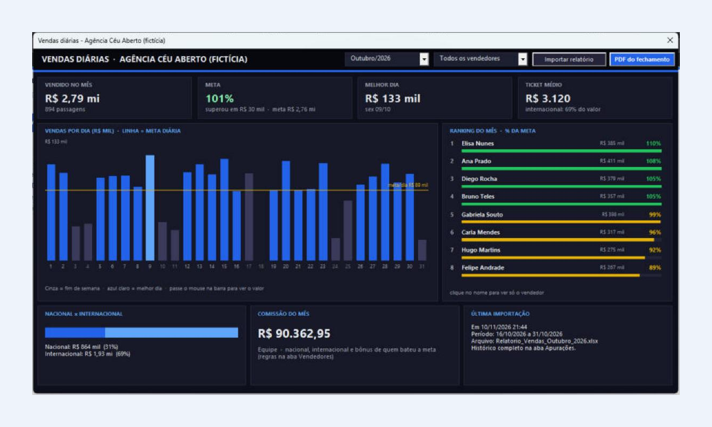
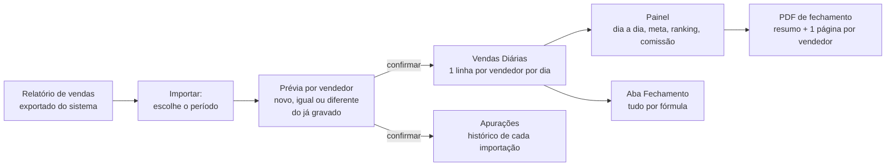
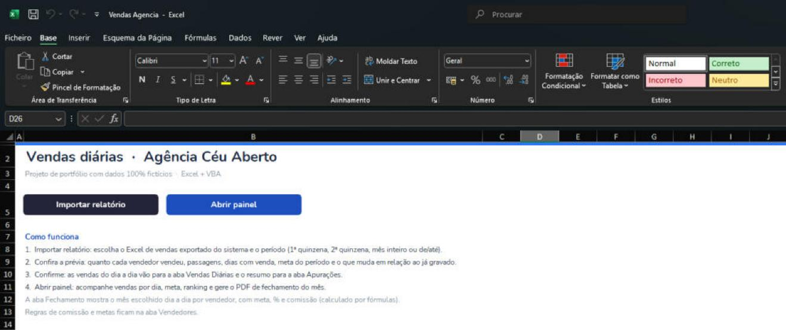
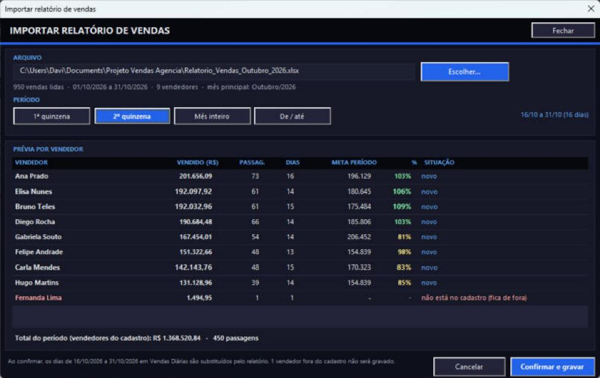
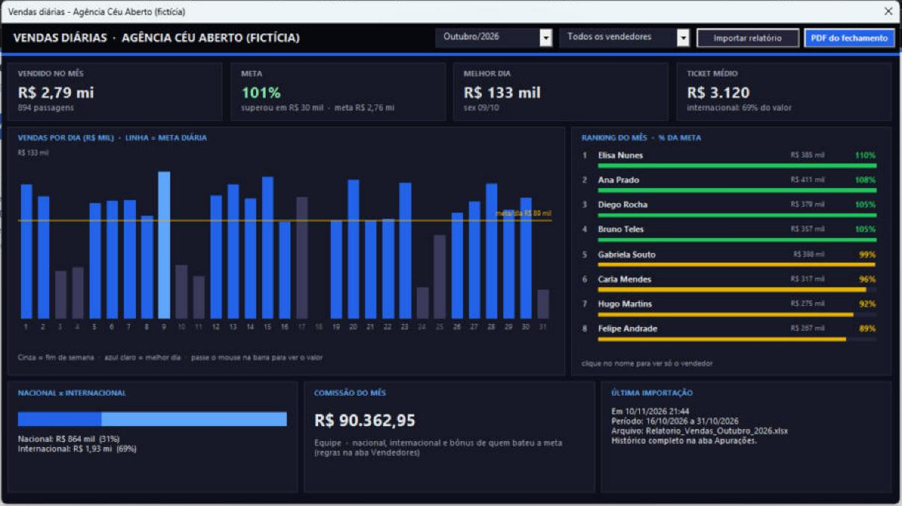
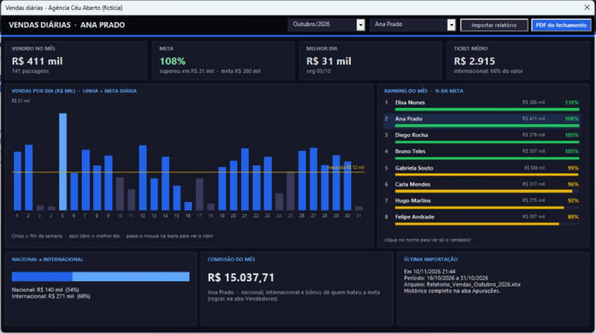
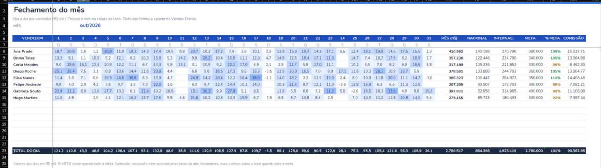
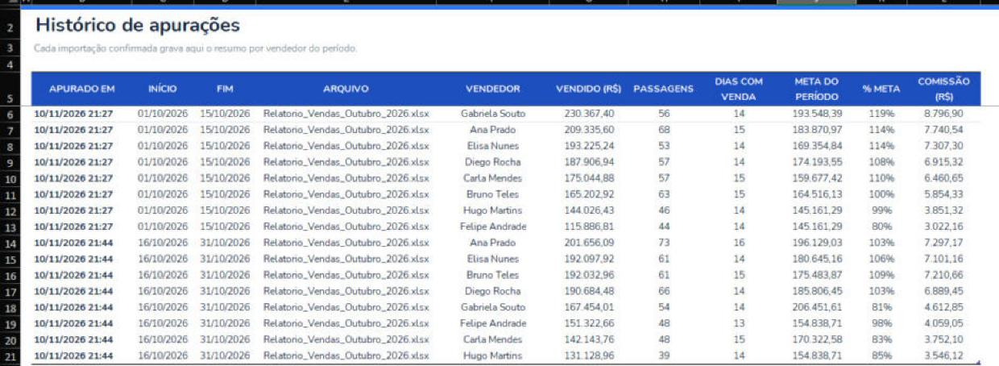
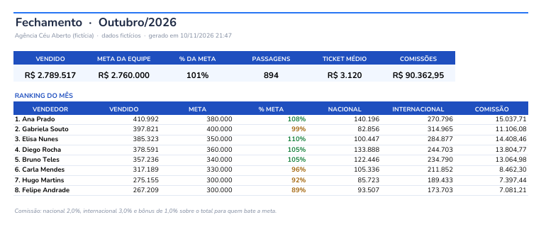
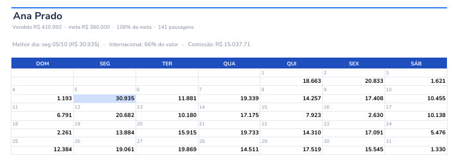

# Vendas diárias por vendedor: importação do relatório, painel e fechamento (Excel + VBA)

Projeto em **Excel/VBA** que lê o **relatório de vendas exportado do sistema** e calcula **quanto cada vendedor vendeu no período escolhido**, seja a 1ª quinzena, a 2ª quinzena, o mês inteiro ou um intervalo de datas. Antes de gravar, mostra uma prévia. Depois, monta um **painel** com vendas por dia, meta, ranking e comissão, e gera o **PDF de fechamento** do mês.

Os exemplos simulam uma agência de passagens aéreas fictícia, a "Agência Céu Aberto", com 8 vendedores e cerca de 950 passagens vendidas em outubro.

> **Sobre este repositório**
> Este repositório é uma **vitrine**. As imagens são **capturas de tela reais** do projeto funcionando no Excel. A agência, os vendedores, as companhias aéreas, os localizadores e os valores foram **inventados**.
> O **código-fonte (VBA) não está publicado**. Veja a seção [Código-fonte](#código-fonte).

---

## O problema

- O sistema da agência exporta um Excel com uma linha por passagem: data, vendedor, trecho, tipo (nacional ou internacional) e valor. Cancelamentos vêm com valor negativo.
- Toda quinzena alguém precisava filtrar o arquivo, somar por vendedor, descontar os cancelamentos, comparar com a meta e calcular a comissão à mão.
- Na metade do mês, comparar com a meta do mês inteiro deixava todo mundo "no vermelho". O certo é comparar com o que era esperado até aquele dia.

## A solução

1. **Importar:** você escolhe o Excel do sistema e o período. O painel encontra sozinho as colunas de data, vendedor, valor, tipo e status.
2. **Conferir:** a prévia mostra, para cada vendedor, o valor vendido, as passagens, os dias com venda, a meta do período e o que muda em relação ao que já estava gravado. Quem não está no cadastro aparece em vermelho e fica de fora.
3. **Acompanhar:** o painel mostra o mês dia a dia, a meta (proporcional, se o mês ainda não terminou), o ranking e a comissão. Um clique no nome filtra o painel para aquele vendedor.
4. **Fechar:** um botão gera o PDF com o resumo da equipe e uma página por vendedor, com o calendário do mês.

---

## Funcionalidades

| | |
|---|---|
| **Importação** | Lê o Excel do sistema e encontra as colunas pelo nome do cabeçalho, mesmo fora de ordem. Desconta cancelamentos (valor negativo ou status "Cancelada"). |
| **Períodos** | 1ª quinzena, 2ª quinzena, mês inteiro ou de/até. Reimportar um período substitui os dias dele, sem duplicar. |
| **Prévia antes de gravar** | Total, passagens, dias com venda, meta do período e % por vendedor. Situação "novo", "igual ao já gravado" ou "já gravado: R$ X", e alerta de vendedor fora do cadastro. |
| **Meta proporcional** | A meta de cada dia é a meta do mês dividida pelos dias do mês. Com o mês parcial, o % compara com o esperado até o último dia importado. |
| **Painel** | Vendido no mês, % da meta, melhor dia, ticket médio, gráfico diário com a linha da meta, ranking por % da meta, mix nacional/internacional, comissão e última importação. |
| **Filtro por vendedor** | Pela lista ou clicando no nome no ranking. Um segundo clique volta para a equipe. |
| **Comissão** | 2% nas vendas nacionais, 3% nas internacionais e +1% sobre o total para quem bate a meta. As taxas ficam na aba Vendedores e podem ser trocadas. |
| **Aba Fechamento** | Matriz vendedor × dia do mês, com total, nacional, internacional, meta, % e comissão, tudo por fórmula (`SUMIFS`), com mapa de calor. |
| **PDF de fechamento** | Resumo da equipe, ranking e uma página por vendedor com o calendário do mês e o melhor dia destacado. Em mês parcial, o título vira "Parcial" e a meta é proporcional. |
| **Histórico** | Cada importação confirmada grava o resumo na aba Apurações, com data, período e arquivo de origem. |
| **Instalação** | Um único `.bas` instala os formulários, as classes, o módulo e os botões, e pode ser rodado de novo sem duplicar nada. |

---

## Telas

### Planilha

### Importar o relatório (prévia da 2ª quinzena)

A vendedora em vermelho aparece no relatório, mas não está no cadastro, e por isso não é gravada. O aviso no rodapé diz exatamente quais dias serão substituídos.

### Painel do mês

Cinza indica fim de semana, azul claro o melhor dia, e a linha amarela é a meta diária. No ranking, a cor segue o % da meta: verde a partir de 100%, amarelo entre 80% e 99% e vermelho abaixo de 80%.

### Painel filtrado por vendedor

### Aba Fechamento (por fórmula)

### Histórico de apurações

### PDF de fechamento

---

## Exemplos (dados fictícios)

| Arquivo | O que é |
|---|---|
| [`exemplos/Relatorio_Vendas_Outubro_2026.xlsx`](exemplos/Relatorio_Vendas_Outubro_2026.xlsx) | O relatório "exportado do sistema": 950 linhas de outubro, com cancelamentos e uma vendedora fora do cadastro. |
| [`exemplos/Planilha_Exemplo.xlsx`](exemplos/Planilha_Exemplo.xlsx) | A planilha com outubro já importado (as duas quinzenas): vendedores, vendas diárias, apurações e fechamento. Só os dados e as fórmulas, sem macros. |
| [`exemplos/Fechamento_Outubro_2026.pdf`](exemplos/Fechamento_Outubro_2026.pdf) | O PDF gerado pelo painel. |

---

## Tecnologias e técnicas

- **Excel VBA:**
  - formulários (UserForms) montados **inteiramente por código**, com tema escuro;
  - eventos centralizados numa classe `WithEvents`;
  - gráfico de barras desenhado com rótulos, sem objeto de gráfico.
- **Leitura do relatório:** abre o arquivo do sistema só para leitura, lê tudo de uma vez para a memória (arrays) e encontra as colunas pelo nome do cabeçalho.
- **Apuração em memória:** `Scripting.Dictionary` por vendedor e por dia, e uma classe de resumo que soma vendas, passagens, nacional, internacional e cancelamentos.
- **Gravação sem duplicar:** remove os dias do período e grava os novos numa única escrita na tabela (`ListObject`), em ordem de data e vendedor.
- **Fórmulas na aba Fechamento:** `SUMIFS` com referências estruturadas, `EOMONTH` e nomes definidos (mês, taxas de comissão).
- **PDF:** uma aba temporária montada por código, com quebras de página por vendedor, exportada com `ExportAsFixedFormat` e apagada em seguida.
- **Instalador em um único `.bas`:** grava formulários, classes e módulo no projeto VBA e cria os botões na aba Início.

Os detalhes estão em [`docs/arquitetura.md`](docs/arquitetura.md).

### Limitações conhecidas

- O nome do vendedor no relatório precisa ser igual ao do cadastro. Acentos, maiúsculas e espaços extras são ignorados.
- O relatório precisa ter, pelo menos, colunas com "DATA", "VENDEDOR" e "VALOR" no cabeçalho.

---

## Código-fonte

O código VBA **não faz parte deste repositório**.
Este repositório serve para apresentar o projeto: o problema, a solução, as telas e os resultados. Para conversar sobre o projeto ou ver uma demonstração, entre em contato pelo meu perfil.

## Licença

© 2026. Todos os direitos reservados. As imagens e os exemplos são só para visualização (veja [LICENSE](LICENSE)).
