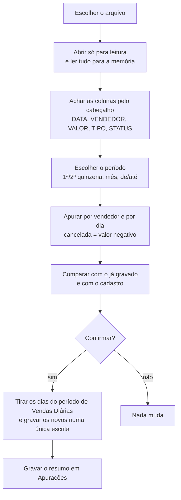

# Arquitetura (visão geral)

> Descrição conceitual. O código-fonte não está publicado.

## Componentes

| Componente | Papel |
|---|---|
| **Módulo principal** | Lê o relatório, apura o período, grava as tabelas, fornece os dados do painel e gera o PDF de fechamento. |
| **Formulário de importação** | Escolha do arquivo e do período, prévia por vendedor e confirmação. |
| **Formulário do painel** | Indicadores, gráfico por dia, ranking, mix nacional/internacional, comissão e última importação. Filtros de mês e vendedor. |
| **Classe de resumo** | Acumula, por vendedor, o vendido, as passagens, o nacional, o internacional, os cancelamentos e o dia a dia. |
| **Classe de eventos** | Recebe cliques e mudanças dos controles criados por código (`WithEvents`) e repassa ao formulário. |
| **Instalador** | Um único `.bas` que grava os componentes no projeto VBA e cria os botões na aba Início. |

## Abas e tabelas

| Aba | Tabela | O que guarda |
|---|---|---|
| **Vendedores** | `tb_Vendedores` | Nome, meta mensal e se está ativo. Ao lado, as taxas de comissão (nomes definidos). |
| **Vendas Diárias** | `tb_Diario` | Uma linha por vendedor por dia: vendido, passagens, nacional, internacional, cancelado e arquivo de origem. |
| **Apurações** | `tb_Apuracoes` | Uma linha por vendedor a cada importação confirmada: período, vendido, passagens, dias com venda, meta do período, % e comissão. |
| **Fechamento** | (fórmulas) | Matriz vendedor × dia do mês escolhido, com totais, meta, % e comissão. |

## Importação

## Regras de cálculo

- **Vendido:** soma dos valores do período. Cancelamentos entram negativos.
- **Passagens:** emitidas menos canceladas.
- **Meta do período:** para cada dia do período, a meta mensal dividida pelos dias daquele mês.
- **Meta no painel com mês parcial:** a meta do mês × (último dia importado ÷ dias do mês).
- **Comissão:** nacional × taxa nacional + internacional × taxa internacional, mais o bônus sobre o total quando o vendedor bate a meta do mês.

## PDF de fechamento

Uma aba temporária é montada por código: resumo da equipe, ranking e, para cada vendedor, um calendário do mês (domingo a sábado) com o valor de cada dia e o melhor dia destacado. A aba é exportada para PDF, com uma quebra de página por vendedor e o rodapé com a numeração, e depois é apagada.
